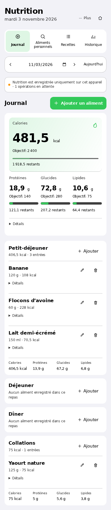
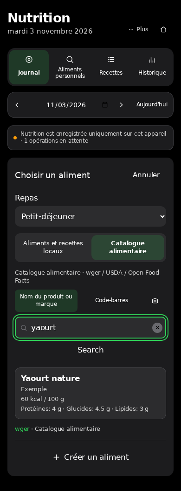

# openGym — training and nutrition, on your own server

Plan workouts, log sets and body weight, and keep a food journal in one self-hosted app.

This is [solhren/openGym](https://github.com/solhren/openGym), a fork of
[DuarteSantos8/openGym](https://github.com/DuarteSantos8/openGym). Duarte Santos and the upstream
contributors built the original application. This fork adds an experimental Nutrition workflow
and local food-catalogue integration. The application code retains its GNU AGPL license;
third-party data and media have separate terms.

**Status: source beta candidate on `review/public-readiness`, awaiting maintainer review.**
This branch is prepared locally; it has not been published by this review. The existing
personal beta on `feature/nutrition` is a separate deployment. The current public scope is
Web self-hosting source, personal or multi-user accounts, and an optional small Ciqual
catalogue. Real Docker acceptance and generic Android compilation/device tests are deferred
manual validations. International OFF/wger installation is deferred to a future version.
Do not treat upstream images, APKs or CI badges as evidence for this candidate.
See the [publication checklist and evidence](docs/PUBLICATION.md) before distributing it.

[Get started](docs/QUICK_START.md) · [FAQ](docs/FAQ.md) · [Self-hosting](docs/SELF_HOSTING.md) ·
[Contribute](CONTRIBUTING.md) · [Security](SECURITY.md)

## What you can do

- **Train:** create weekday or rotating routines, run guided sessions, record sets, use rest
  timers and review workout history. The inherited exercise library includes instructions and
  media with [separate usage restrictions](NOTICE.md).
- **Track progress:** log body weight and review training charts and personal records.
- **Keep a food journal:** enter personal foods, quantities and meals; save recipes; review daily
  calories, protein, carbohydrates and fat against goals you choose.
- **Preserve meal history:** entries keep food or recipe snapshots so later edits to a saved food
  do not silently rewrite old meals. Nutrition includes its own backup preview and restore flow.
- **Choose account access:** personal mode admits one owner; multi-user mode uses
  invitations by default, with an explicit public-signup option and account limit.
  Workouts and meals remain private to their account. The host operator is trusted.
- **Use your own devices:** a web interface and installable PWA, with account-based synchronization
  when connected to your server. Capacitor mobile sources are included.
- **Search locally:** the new opt-in starter installation acquires Anses Ciqual 2025
  directly from its publisher and builds a small SQLite of generic foods with official
  English/French names. It has no retail barcodes. The separate experimental wger/OFF
  mode retains barcode support but is not a portable download offered by this installer.

The AI coach and [MCP integration](mcp/README.md) are optional. Review their configuration and
what data they expose before enabling them. Neither is required for workout or food logging.

## Preview

**Synthetic demonstration data, French interface.** These screenshots show real Nutrition UI
components with invented meals, goals and a simulated catalogue response. They contain no real
account or user history and do not demonstrate live catalogue coverage or camera scanning.

<table>
<tr>
<td></td>
<td></td>
</tr>
<tr><td>Journal · light theme</td><td>Catalogue picker · dark theme</td></tr>
</table>

[Wider dark-theme preview](docs/assets/nutrition/journal-tablet-dark.png) ·
[Image provenance and limits](docs/assets/nutrition/README.md)

## Quick start

Follow the [beginner quick start](docs/QUICK_START.md), then keep the
[administrator guide](docs/SELF_HOSTING.md) for HTTPS, backups, updates and rollback.
Both use Docker Compose built from a reviewed checkout of **this fork**. The
installer requires no maintainer domain, private catalogue or signing key.

Choose personal or multi-user mode separately from your food sources. Personal is
the default; both profiles require authentication, disable guest/password login
and protect the first administrator with a private bootstrap invitation. Invited
multi-user registration is the default; public signup requires an explicit choice.
Read [account policies and recovery limits](docs/dev/PUBLIC_ACCOUNT_MODES.md).

The review branch has not been published automatically. Do not substitute an
upstream image or assume the development branch already has these tools. For hot
reload without deployment, use [Contributing](CONTRIBUTING.md#local-development).

Once the app is running:

1. Open the configured hostname and create the first passkey profile using the
   private invitation from your instance directory. Add a second passkey while
   access works; the server cannot recreate an authenticator private key.
2. Create a simple workout routine and log a set to check the training workflow.
3. Open **Nutrition**, search for `rice` or `riz` if Ciqual is selected, inspect its
   100 g reference and add a quantity. Personal foods from labels work without a
   public catalogue.
4. Set goals only if you want them. Missing goals and missing nutrient values are not zeroes.
5. Export a Nutrition backup and keep it somewhere outside the browser or phone.

**Food logging does not require a multi-gigabyte catalogue.** The recommended
Ciqual acquisition is an explicit approximately 3.13 MB download, producing a
roughly 14 MB SQLite. No nutrition database is shipped in Git or fetched at API
startup. You can also choose personal foods only or later disable a catalogue
without deleting saved foods or journal snapshots. See the [FAQ](docs/FAQ.md#why-is-food-search-empty-or-unavailable).

Passkeys on another device require HTTPS with a correctly configured hostname and origin.
Choose the public hostname before creating accounts. Server operators can read stored data;
self-hosting is not end-to-end encryption.

## Food data and current limits

The separate personal-beta evaluation retains **3,058,354 wger product rows** and adds **835,231 strictly
validated Open Food Facts food records**. These are processing counts, not the number of distinct
foods you can necessarily add, and not a bundled database.

In a frozen independent benchmark, **544 of 913 supported sample barcodes were addable (59.6%)**.
This measures that particular sample and generation. It does not establish coverage of French
supermarkets, relevance of search results, or nutritional accuracy. See the
[benchmark methodology](docs/dev/NUTRITION_CATALOG_BENCHMARK.md) and
[catalogue implementation notes](docs/dev/NUTRITION_FOOD_CATALOG.md).

Current limitations include:

- The portable starter supports 3,484 generic Ciqual foods with official English/French
  names: 3,006 complete, 473 with unknown values, and 5 not addable. It is a French
  composition table, not worldwide brand coverage. International OFF/wger installation is
  deferred to a future version and unavailable in this public installer. Existing personal-beta
  catalogues are separate.
- Selecting several source IDs is not yet a working OFF + wger + Ciqual union.
  Only Ciqual has a complete portable acquisition/reader path in this installer.
- Real Docker execution of the new installer remains unverified in this environment;
  source-level, HTTP, catalogue and configuration tests do not replace it.
- Local search has no typo correction. Some products are absent, ambiguous or lack enough
  trustworthy quantity/nutrition information to add safely.
- Nutrition supports Nutrition-only restore. Applying a combined workout-and-Nutrition restore
  is deliberately blocked; export does not imply every dataset can be restored together.
- Generic Android is separate source/build work under review, with no compiled
  public APK validated here. The personal Android beta and a real scanner test
  provide limited device evidence; they do not certify arbitrary phones, browser
  cameras, iOS, or recovery after physical power loss.
- Long archives can increase write, sync and recovery costs. Back up before relying on a beta
  for your only copy of history.
- This is a tracker, not a clinical or dietary recommendation service. Check food values and
  units against the package label.

Some older guides describe upstream behavior or earlier Nutrition experiments. For this fork,
start here and in the current self-hosting guide; development notes are implementation evidence,
not universal deployment instructions.

## Documentation and project layout

| Need | Start here |
| --- | --- |
| Install for the first time | [Quick start](docs/QUICK_START.md) |
| Administer, back up, update or roll back | [Self-hosting](docs/SELF_HOSTING.md) |
| Understand personal/multi-user isolation and recovery | [Account policies](docs/dev/PUBLIC_ACCOUNT_MODES.md) |
| Understand the code and data boundaries | [Architecture](docs/ARCHITECTURE.md) |
| Understand storage, search or scanning behavior | [FAQ and troubleshooting](docs/FAQ.md) |
| Build Android for your own server | [Generic Android guide](docs/ANDROID_SELF_HOSTING.md) |
| Work on the code | [Contributing](CONTRIBUTING.md) |
| Understand security and reporting availability | [Security policy](SECURITY.md) |
| Review Nutrition backup behavior | [Backup design and limits](docs/dev/NUTRITION_BACKUP_RESTORE.md) |
| Prepare a source beta and GitHub settings | [Publication checklist](docs/PUBLICATION.md) |
| Review the launch draft and evidence limits | [Public launch notes](docs/PUBLIC_LAUNCH.md) |

`frontend/` contains React, Vite and the Capacitor shells. `api/` contains the Node HTTP API and
Nutrition synchronization endpoints. `web/` serves the built web app through nginx. `catalogue/`
holds the exercise catalogue. `scripts/nutrition-local-catalog/` holds experimental food-catalogue
preparation and validation tools; it is separate from the local journal storage on each device.

## License and attribution

- **Application code:** GNU AGPL v3 or later, as declared by the package metadata; see
  [LICENSE](LICENSE) and preserve the existing [NOTICE.md](NOTICE.md), including upstream
  attribution and its stated additional permission. The [AGPL text, section 13](https://www.gnu.org/licenses/agpl-3.0.html#section13)
  addresses corresponding source for modified versions used over a network.
- **Exercise text, diagrams and media:** follow [NOTICE.md](NOTICE.md). In particular, the Gym
  visual exercise media are not AGPL assets or a freely reusable media pack. This fork does not
  grant additional media permissions or certify the scope of the upstream media agreement.
- **Ciqual starter:** Anses Ciqual 2025, under [Licence Ouverte Etalab 2.0](https://www.data.gouv.fr/pages/legal/licences/etalab-2-0),
  verified against the [publisher's dataset metadata](https://entrepot.recherche.data.gouv.fr/api/datasets/:persistentId/?persistentId=doi:10.57745/RDMHWY).
  The installer downloads the original files explicitly; no food database is bundled here.
  Keep the source, data date and transformation notice with derived records.
- **Food records:** keep each record's source, author and license information. wger is a data
  source, not one blanket license for all imported records; its
  [official license notes](https://wger.readthedocs.io/en/latest/#licence) describe its initial
  ingredient data separately from application code.
- **Open Food Facts:** database rights use [ODbL 1.0](https://opendatacommons.org/licenses/odbl/1-0/);
  individual contents use [DbCL 1.0](https://opendatacommons.org/licenses/dbcl/1-0/). Product images
  have separate CC BY-SA terms and may involve other rights. See the
  [official OFF licensing guide](https://openfoodfacts.github.io/openfoodfacts-server/api/tutorials/license-be-on-the-legal-side/).

Keeping attribution in snapshots is part of the implementation, not a determination that every
combined database or publicly shared backup is lawful to redistribute. Public redistribution of
the composed catalogue has **not** been validated. Review the actual records, source terms and
intended distribution before publishing data.
