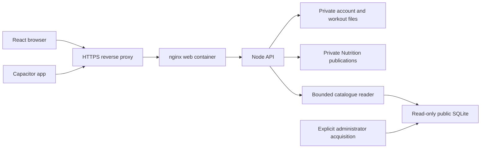

# Architecture and data boundaries

Start with [Self-hosting](SELF_HOSTING.md) to operate an instance and
[CONTRIBUTING](../CONTRIBUTING.md) to change the code. This map explains where a
change belongs; the linked contracts contain the detailed formats and invariants.
The public installation and personal beta are separate deployment profiles.

## Processes and responsibilities

The public Compose profile publishes only a loopback web port. Its API is on an
internal network; a separate administrator-configured proxy terminates HTTPS.
The API network cannot call external providers. This also limits optional Coach
and push features: it is not an invisible selective firewall for food APIs only.

Catalogues are independent of account storage. The application never installs a
food database as part of a search. Acquiring or enabling a source is a separate
administrator action with source/licence and resource checks. Currently the
portable installer supplies Ciqual; the historical wger/OFF deployment remains
separate. See [actual capabilities](dev/PUBLIC_CATALOG_INSTALLATION.md).

## Application modules

| Area | Entry points | Responsibility |
| --- | --- | --- |
| Navigation and identity | `frontend/src/App.jsx`, `store/useStore.js` | Existing workout navigation and active account/session |
| Nutrition view | `views/Nutrition.jsx`, `views/nutrition/` | Forms, dates, accessibility and presentation |
| React/session adapter | `lib/nutrition/use-nutrition.jsx`, `ui-session.js`, `ui-service.js` | Bind active identity to commands and read models |
| Shared Nutrition model | `api/nutrition/core/` | Runtime-neutral validation, units and calculations; frontend modules re-export it |
| Local persistence | `lib/nutrition/local-store.js`, `local-store-idb.js`, `local-store-fs.js` | Scoped durable publications, progressive reads and pending operations |
| Synchronization | `lib/nutrition/sync.js`, `sync-merge.js`; `api/nutrition/routes.js`, `store.js` | Conditional revisions, replay, conflict preservation and server authorization |
| Nutrition backup | `lib/nutrition/backup.js`, `backup-contract.js`, `backup-restore.js` | Versioned export, verification, preview and guarded restoration |
| Catalogue boundary | `api/nutrition/catalog-local.js`; `lib/nutrition/catalog/` | Authenticated local search and validation before records become Foods |
| Portable source tools | `scripts/nutrition-local-catalog/public-*` | Pinned source acquisition, SQLite generation and bounded read-only worker |
| Instance lifecycle | `scripts/self-hosting/`, `deploy/self-hosting/` | Frozen source, configuration, catalogue selection, offline backup and restore |

Paths in this table are relative to the repository, except frontend paths, which
are relative to `frontend/src/`. Neither React components nor a catalogue importer
should invent a second implementation of nutrient calculations or sync merging.

## Recording a meal

1. Search returns a public record, never a user history. An untrusted provider DTO
   passes the strict local-product adapter before it can become a validated Food.
2. The quantity engine uses the Food's explicit reference and compatible units.
   Unknown values remain unknown; a numeric zero is a known value. Millilitres and
   grams are interchangeable only with an explicit supported density.
3. UI commands create the saved food and food-entry snapshot through the local
   publication protocol. React state is a view of that durable state, not the
   authoritative journal.
4. Pending operations persist before any network attempt. Sync can acknowledge
   them only through the existing revision/idempotence protocol. UI local success
   must never be labelled server synchronization success.
5. Later source changes or source removal cannot rewrite a consumed snapshot.
   Recipes likewise retain the relevant ingredient/source information.

Read [the persistence contract](dev/NUTRITION_PERSISTENCE.md),
[local storage](dev/NUTRITION_LOCAL_STORAGE.md),
[server API](dev/NUTRITION_SERVER_API.md), and
[sync protocol](dev/NUTRITION_SYNC.md) before changing these boundaries. Workout
synchronization is a separate existing mechanism and must not be refactored as a
side effect of a Nutrition change.

## Identity and concurrency

Browser sessions and paired native sessions use the existing authenticated API.
The client scopes Nutrition by profile and server origin. Session generations
guard asynchronous reads/writes so a response for a previous account cannot
mutate the new account. Closing a view does not discard pending operations.
Server routes derive the authenticated user from the session rather than trusting
a user ID supplied in a request body.

Personal/multi-user instance policy is separate from document ownership. In the
explicit public modes, an administrator manages accounts and invitations without
receiving other users' workout or meal content. The legacy administrative API
predates this restriction and can expose workout data; do not equate its default
configuration with the explicit public policy. The host operator remains trusted and can read
the server files; this is not end-to-end encryption. See [SECURITY](../SECURITY.md).

Concurrency belongs at the persistence/publication boundary: conditional revisions,
durable manifests, interrupted-write recovery and preserved divergent versions.
Do not resolve a conflict by deleting the pending queue or replacing a store with
an arbitrary React snapshot. Error messages should report recovery/conflict states
without including another account's content or credentials.

## Three different backup concerns

- **Nutrition portable backup:** a user-level versioned archive with strict
  validation and a preview. Restored content goes through the existing command,
  publication and synchronization protections. Combined workout+Nutrition
  restoration remains deliberately unavailable; it is not globally atomic.
- **Whole server backup:** `scripts/self-hosting/backup.py` stops API writes and
  archives the private data directory, including accounts and server secret. It
  restores only into a new directory. This operator backup is sensitive and is not
  a portable user export.
- **Public catalogue recovery:** retain source receipts, licences, sealed SQLite
  generations and registry snapshots separately. User archives do not contain the
  complete food catalogue. Reacquiring a changed source is not an exact rollback.

See [Nutrition backup/restore](dev/NUTRITION_BACKUP_RESTORE.md) and the administrator
guide. Hashes detect accidental damage; they do not authenticate an attacker who
can replace both the archive and its checksum.

## Safe extensions

To add a regional source, supply a source descriptor with measured size/limits,
licence/provenance, an actual importer, immutable generation validation, a bounded
reader, a strict DTO conversion and missing-value/reference tests. Only then mark
it available. An empty descriptor is not source support. Match identities only
with evidence; do not combine nutrient fields from conflicting records or turn a
generic food code into a retail barcode.

To modify initialization, test empty storage, reopen, account/server changes,
interruption and explicit failure. To modify a deployment profile, test its
configuration and recovery journal before testing actual containers. Distinguish
those evidence levels in review notes. Real browser and device checks remain
necessary for native permissions, cameras, passkeys and physical storage behavior.
